# Angular + RxJS Kripto Dashboard

> **Proje Kodu:** P06 · **Zorluk:** Orta · **Puan:** 45 · **Hafta:** 1

**Öğrenci:** ABDOU VALERIO FOMA KENFACK  
**Öğrenci No:** 24080410152  
**E-posta:** fomavalerio@gmail.com  
**Ders:** BMU1208 Web Tabanlı Programlama — *Dr. Öğr. Üyesi Davut ARI*  
**Kurum:** Bitlis Eren Üniversitesi — Mühendislik-Mimarlık Fakültesi — Bilgisayar Mühendisliği  
**Dönem:** 2025-2026 Bahar  
**Son Güncelleme:** 17.05.2026

---

## İçindekiler

1. [Proje Künyesi](#1-proje-künyesi)
2. [Executive Summary](#2-executive-summary)
3. [Problem ve Motivasyon](#3-problem-ve-motivasyon)
4. [Hedef Kitle ve Persona](#4-hedef-kitle-ve-persona)
5. [Ürün Gereksinimleri (PRD)](#5-ürün-gereksinimleri-prd)
6. [Piyasa ve Rekabet Analizi](#6-piyasa-ve-rekabet-analizi)
7. [Teknoloji Yığını (Tech Stack)](#7-teknoloji-yığını-tech-stack)
8. [Sistem Mimarisi](#8-sistem-mimarisi)
9. [Veri Modeli ve API Tasarımı](#9-veri-modeli-ve-api-tasarımı)
10. [UI/UX Tasarımı](#10-uiux-tasarımı)
11. [Güvenlik, Performans, Test](#11-güvenlik-performans-test)
12. [Maliyet, Gelir Modeli, GTM](#12-maliyet-gelir-modeli-gtm)
13. [Ek: Post-Launch Review](#13-ek-post-launch-review)

---

## 1. Proje Künyesi

| Alan | Değer |
|------|-------|
| Proje Adı | Angular + RxJS Kripto Dashboard |
| Proje Kodu | P06 |
| Slogan (1 cümle) | Portföyünüz ve takip listeniz tek ekranda, gerçek zamanlı. |
| Kategori | Finance / Kripto / Productivity |
| Hedef Platform | Web (responsive) · PWA |
| GitHub | https://github.com/FKAV64/web-based-progrmming-end-of-year-project |
| Canlı Demo | https://web-based-progrmming-end-of-year-pr.vercel.app |
| Demo Kullanıcı | Email: `demo@example.com` · Şifre: `Demo#123` |
| Lisans | MIT |
| Başlangıç | 2026-04-15 |
| Hedef Bitiş | 2026-06-15 |
| Durum | 🟢 Launched (V1 / MVP — Vercel + Railway'de canlı) |

### Varsayılan Tech Stack (özet)

| Katman | Teknolojiler |
|--------|--------------|
| Frontend | Angular 17 (standalone components, signals), Angular Material, Tailwind CSS 3 |
| Reaktiflik | RxJS 7 (Observable, Subject, operators) |
| Grafik | ApexCharts (`ng-apexcharts`) |
| Backend | NestJS 11, Prisma 5, PostgreSQL 16, Redis 7 |
| Veri Kaynağı | CoinGecko API, Binance WebSocket, Alternative.me Fear & Greed, RSS haber akışı |
| State | Servis-tabanlı (Angular signals + RxJS) |
| Test | Jest + Supertest (backend), Jest + Angular Testing Library (frontend), Playwright (e2e) |
| Hosting | Vercel (frontend) · Railway (backend) |

> Detaylar için Bölüm 7.

---

## 2. Executive Summary

*3 paragraf, toplam ~200-300 kelime. Bir yatırımcı / işe alım mülakatında 2 dakikada anlatacak özet.*

### 2.1 Ne Yapıyoruz?

Angular + RxJS Kripto Dashboard, bireysel kripto yatırımcıları için
gerçek zamanlı bir izleme panelidir. Kullanıcı; top‑100 coin'in canlı
fiyatını WebSocket üzerinden takip eder, kişisel watchlist ve portföy
(kâr/zarar) yönetir, fiyat alarmı kurar ve bunları web‑push bildirimi
olarak alır. Ana değer; borsaların reklam yoğun arayüzü yerine sade,
hızlı, TR/EN ve koyu mod destekli, ana ekrana eklenebilen (PWA) kişisel
bir kontrol panelidir.

### 2.2 Neden Şimdi?

Kripto varlık sahipliği bireysel yatırımcı tabanında genişlemeye devam
ediyor; kullanıcılar genellikle aynı anda birden çok borsa ve cüzdan
kullandığı için varlıklarını tek ekranda toplulaştıran hafif araçlara
ihtiyaç duyuyor. Tarayıcı tarafında WebSocket + PWA + push bildiriminin
olgunlaşması, sunucu maliyeti düşük ama "uygulama gibi" çalışan bir
dashboard'u mümkün kılıyor. Bu proje aynı zamanda BMU1208 dersi
kapsamında RxJS reaktif programlama yetkinliğini somut bir üründe
göstermeyi hedefler.

### 2.3 Başarı Nasıl Görünüyor?

Bu bir ders projesi olduğundan birincil başarı ölçütü; tüm MVP
özelliklerinin canlı ortamda (Vercel + Railway) çalışır olması, CI'nin
yeşil olması ve test kapsamının hedefte tutulmasıdır. Ürünleştirme
senaryosunda 1. yıl hedefi: ~500 aktif kullanıcı, NPS ≥ 40; 3. yıl
hedefi: ~5.000 aktif kullanıcı ve sürdürülebilir freemium dönüşümü.

---

## 3. Problem ve Motivasyon

### 3.1 Hangi Probleme Çözüm Getiriyoruz?

Bireysel kripto yatırımcısı varlıklarını çoğu zaman birden fazla borsa,
cüzdan ve mobil uygulama arasında dağınık şekilde takip eder. Fiyatı
kaçırmamak için sürekli uygulama değiştirmek, kâr/zarar durumunu kafadan
hesaplamak ve önemli seviyeleri elle kontrol etmek yorucudur. Biz; tek
ekranda canlı fiyat, kişisel watchlist, portföy P&L ve otomatik fiyat
alarmı sunarak bu dağınıklığı ve "an'ı kaçırma" kaygısını azaltıyoruz.

### 3.2 Kanıt: Problem Gerçekten Var Mı?

- **Gözlem:** Yatırımcılar genellikle 2+ borsa/cüzdan kullanır; toplam
  varlığı görmek için elle toplama yaparlar.
- **Kullanıcı ihtiyacı:** "Fiyat şu seviyeye gelince haber ver" en sık
  istenen özelliklerden biridir; çoğu sade arayüzlü araçta yoktur.
- **Pazar bağlamı:** Mevcut popüler takip uygulamaları reklam/again
  yoğun veya ücretli premium ardına gizlenmiş gelişmiş alarm sunar.

> Not: Bu bölümdeki dış kaynak linkleri (Google Trends, forum) ders
> kapsamı dışında olduğundan eklenmemiştir.

### 3.3 Mevcut Çözümler ve Eksikleri

| Mevcut çözüm | Kullanıcıya ne vadeder? | Neden yetersiz? |
|--------------|------------------------|------------------|
| CoinMarketCap / CoinGecko | Geniş piyasa verisi | Reklam yoğun, kişisel portföy/alarm deneyimi ikincil |
| Borsa uygulamaları (Binance vb.) | Alım-satım + grafik | Tek borsaya kilitli, sade "izleme" deneyimi değil |
| Blockfolio/Delta türü mobil | Portföy takibi | Mobil odaklı, web/PWA deneyimi ve özelleştirme sınırlı |

### 3.4 Bizim Diferansiyasyonumuz

1. Reklamsız, sade ve hızlı; tek ekranda fiyat + watchlist + portföy + alarm.
2. Sunucu tarafı alarm motoru + web‑push: tarayıcı kapalıyken de tetiklenir.
3. TR/EN, koyu mod, çoklu para birimi (USD/EUR/TRY) ve PWA kurulum.

### 3.5 Kapsam Dışı Bıraktığımız Problemler (Non-Problems)

- Gerçek alım/satım (order verme) — V1 sadece izleme/analiz; borsa
  entegrasyonu ve cüzdan bağlama V2'ye ertelendi.
- Vergi/raporlama ve çoklu kullanıcı/ekip özellikleri — kapsam dışı.

---

## 4. Hedef Kitle ve Persona

### 4.1 Birincil Segment

22–40 yaş arası, kriptoda küçük/orta büyüklükte pozisyonu olan, günde
birkaç kez fiyat kontrol eden bireysel yatırımcılar (teknolojiye yatkın,
web + mobil web kullanan).

### 4.2 İkincil Segment

Kriptoya yeni başlayan, az sayıda coin takip eden ve basit bir
portföy/alarm aracı arayan kullanıcılar.

### 4.3 Persona Kartları (2 adet)

#### 👩‍💼 Persona 1 — "Elif"

| Alan | Değer |
|------|-------|
| Yaş / Şehir | 29 / İstanbul |
| Rol / Meslek | Yazılım geliştirici, yan gelir olarak kripto |
| Teknoloji kullanımı | Android + masaüstü Chrome, ileri düzey |
| Günlük rutini | Sabah ve akşam fiyat/portföy kontrolü, gün içinde alarm bekler |
| Ana hedefi | Pozisyonlarının P&L'sini ve hedef seviyeleri tek ekranda görmek |
| Pain points | Çok uygulama arası geçiş; alarm kurmanın zor olması; reklam |
| Ürünümüzü ne zaman açar? | Piyasada hareket olduğunu duyduğunda ve alarm bildirimi geldiğinde |
| Motto | *"Ekranı sürekli açık tutmak istemiyorum, önemli olunca haber versin."* |

#### 👨‍🎓 Persona 2 — "Mert"

| Alan | Değer |
|------|-------|
| Yaş / Şehir | 23 / Ankara |
| Rol / Meslek | Üniversite öğrencisi, kriptoya yeni |
| Teknoloji kullanımı | iPhone + dizüstü, orta düzey |
| Günlük rutini | Birkaç coin'i merakla izler, henüz portföyü küçük |
| Ana hedefi | Basitçe watchlist tutmak ve fiyatları anlamak |
| Pain points | Karmaşık borsa arayüzleri; İngilizce terimler |
| Ürünümüzü ne zaman açar? | Ders arası hızlı fiyat bakışı |
| Motto | *"Sade olsun, kafam karışmasın."* |

### 4.4 Jobs To Be Done (JTBD)

1. *"Piyasa hareketliyken, izlediğim coin'lerin fiyatını tek ekranda
   görmek istiyorum, böylece uygulama değiştirmeden karar verebilirim."*
2. *"Hedef fiyatım olduğunda, ekranı izlemek yerine otomatik bildirim
   almak istiyorum, böylece anı kaçırmam."*
3. *"Pozisyon eklediğimde, anlık kâr/zararımı görmek istiyorum, böylece
   genel durumu hızlıca anlarım."*

### 4.5 Persona'lar Hangi Feature'ları Öncelikli Kullanır?

| Özellik | Persona 1 (Elif) | Persona 2 (Mert) |
|---------|------------------|------------------|
| Portföy P&L | Çok | Az |
| Fiyat alarmı + push | Çok | Orta |
| Watchlist | Orta | Çok |
| Haber/Sentiment | Orta | Orta |

---

## 5. Ürün Gereksinimleri (PRD)

### 5.1 Ana Hedef ve North Star Metric

- **Ana hedef:** Kullanıcının kripto varlıklarını ve hedeflerini tek
  ekrandan, gerçek zamanlı ve bildirimli takip etmesini sağlamak.
- **North Star Metric:** Haftalık "aktif takip eden kullanıcı" (en az bir
  watchlist/portföy öğesi veya alarmı olan ve dönen kullanıcı sayısı).
- **Destekleyici metrikler:**
  - Kurulan alarm sayısı / tetiklenen alarm sayısı
  - Watchlist + portföy öğesi olan kullanıcı oranı
  - 7 günlük geri dönüş (retention)

### 5.2 Kapsam

#### In-Scope (V1 — MVP)

1. Kayıt / giriş (Argon2 + JWT, httpOnly cookie, refresh rotasyonu)
2. Top‑100 canlı fiyat (Binance WS proxy) + piyasa tablosu
3. Coin detay + grafik (mum/çizgi/area, çoklu aralık)
4. Kişisel watchlist (sunucu tarafında kalıcı)
5. Portföy: pozisyon ekle/kapat, P&L
6. Fiyat alarmı (ABOVE/BELOW) + web‑push bildirimi
7. Haber akışı + Fear & Greed sentiment
8. Ayarlar: tema (light/dark/system), dil (TR/EN), para birimi (USD/EUR/TRY)
9. KVKK: veri export + hesap silme
10. PWA: kurulum + service worker + push

#### Out-of-Scope (V1'de yok, sonra bakarız)

- Gerçek alım/satım, borsa API entegrasyonu, cüzdan bağlama (V2)
- Vergi/raporlama, çoklu kullanıcı/ekip, mobil native uygulama
- AI destekli strateji / bot (V3)

### 5.3 Fonksiyonel Gereksinimler (User Stories)

Bu bölümde V1 kapsamındaki temel kullanıcı hikâyeleri ve her hikâye için kabul kriterleri yer alır.

#### FR-01 — Kayıt

> As a **ziyaretçi**, I want to **e‑posta + şifre ile hesap açmak**, so that **kişisel verilerimi saklayabileyim**.

**Acceptance Criteria:**
- *Given geçerli e‑posta/şifre, When kayıt formu gönderilir, Then hesap oluşturulur ve dashboard'a yönlendirilir.*
- *Given var olan e‑posta, When kayıt denenir, Then 409 hata gösterilir.*

**Öncelik:** Must · **Tahmini efor:** M

#### FR-02 — Giriş / Oturum yönetimi

> As a **kullanıcı**, I want to **güvenli giriş yapmak ve oturumumun yenilenmesini**, so that **tekrar tekrar giriş yapmayayım**.

**Acceptance Criteria:**
- *Given doğru kimlik, When giriş yapılır, Then access token (Bearer) yanıt gövdesinde döner ve `refresh_token` httpOnly cookie set edilir.*
- *Given süresi dolmuş access token, When istek atılır, Then refresh ile sessiz yenilenir.*
- *Given 15 dk içinde 10 hatalı deneme, When tekrar denenir, Then hesap 15 dk kilitlenir (auth uçlarında ayrıca 5/dk hız limiti).*

**Öncelik:** Must · **Tahmini efor:** L

#### FR-03 — Canlı piyasa tablosu

> As a **kullanıcı**, I want to **top‑100 coin'i canlı fiyatla görmek**, so that **piyasayı tek bakışta anlayayım**.

**Acceptance Criteria:**
- *Given /markets açık, When WS bağlantısı kurulur, Then fiyatlar canlı güncellenir.*
- *Given WS kesilir, Then otomatik yeniden bağlanır ve son snapshot gösterilir.*

**Öncelik:** Must · **Tahmini efor:** L

#### FR-04 — Coin detay + grafik

> As a **kullanıcı**, I want to **bir coin'in grafiğini farklı aralıklarda görmek**, so that **trendi inceleyebileyim**.

**Acceptance Criteria:**
- *Given coin detayı, When aralık (1H/1D/1W/1M/YTD) seçilir, Then grafik güncellenir.*
- *Given grafik, When pinch/zoom yapılır, Then crosshair ve değer gösterilir.*

**Öncelik:** Must · **Tahmini efor:** M

#### FR-05 — Watchlist

> As a **kullanıcı**, I want to **coin'leri takip listeme eklemek**, so that **önemsediklerimi ayrı göreyim**.

**Acceptance Criteria:**
- *Given giriş yapılmış, When coin eklenir/çıkarılır, Then sunucuda kalıcı olur.*
- *Given sayfa yenilenir, Then liste korunur.*

**Öncelik:** Must · **Tahmini efor:** S

#### FR-06 — Portföy ve P&L

> As a **kullanıcı**, I want to **pozisyon (adet × ort. alış) eklemek**, so that **kâr/zararımı göreyim**.

**Acceptance Criteria:**
- *Given pozisyon, When canlı fiyat değişir, Then gerçekleşmemiş P&L hesaplanır.*
- *Given pozisyon kapatılır, Then gerçekleşen P&L sabitlenir.*

**Öncelik:** Must · **Tahmini efor:** L

#### FR-07 — Fiyat alarmı + push

> As a **kullanıcı**, I want to **hedef fiyat alarmı kurmak**, so that **fiyat o seviyeye gelince bildirim alayım**.

**Acceptance Criteria:**
- *Given ABOVE/BELOW alarm, When koşul snapshot'ta sağlanır, Then alarm tetiklenir ve web‑push gönderilir.*
- *Given alarm tetiklendi, Then tekrar tetiklenmez (triggeredAt set).*

**Öncelik:** Must · **Tahmini efor:** L

#### FR-08 — Haber + Sentiment

> As a **kullanıcı**, I want to **haber akışı ve Fear & Greed görmek**, so that **piyasa havasını anlayayım**.

**Acceptance Criteria:**
- *Given /news, Then RSS haberleri listelenir.*
- *Given dashboard, Then güncel sentiment göstergesi gösterilir.*

**Öncelik:** Should · **Tahmini efor:** M

#### FR-09 — Ayarlar (tema/dil/para birimi)

> As a **kullanıcı**, I want to **tema, dil ve para birimini değiştirmek**, so that **kendi tercihime göre kullanayım**.

**Acceptance Criteria:**
- *Given ayar değiştirilir, Then anında uygulanır ve sunucuda saklanır.*
- *Given para birimi değişir, Then tüm fiyatlar dönüştürülerek gösterilir.*

**Öncelik:** Should · **Tahmini efor:** M

#### FR-10 — KVKK: veri export + hesap silme

> As a **kullanıcı**, I want to **verimi indirmek ve hesabımı silmek**, so that **veri kontrolüm bende olsun**.

**Acceptance Criteria:**
- *Given /me/export, Then kullanıcı verisi JSON olarak indirilir.*
- *Given hesap silme onaylanır, Then ilişkili tüm veriler cascade silinir ve /login'e yönlendirilir.*

**Öncelik:** Must · **Tahmini efor:** M

### 5.4 Non-Functional Requirements

| Kategori | Gereksinim | Nasıl ölçülecek? |
|----------|------------|-------------------|
| Performans | P95 API response < 500ms | Sentry Performance |
| Performans | LCP < 2.5s (Web Vitals) | Lighthouse CI |
| Güvenlik | OWASP Top 10 kontrolleri | manuel checklist + ZAP tarama |
| Erişilebilirlik | WCAG 2.1 AA | axe DevTools |
| Uyumluluk | Son 2 majör Chrome, Firefox, Safari | BrowserStack |
| Lokalizasyon | TR + [EN?] | i18n keys |
| SEO | Core Web Vitals ≥ 90 | Lighthouse |
| Erişim | 99% uptime (aylık) | UptimeRobot |

### 5.5 Bağımlılıklar ve Riskler

| Bağımlılık | Risk | Azaltma |
|------------|------|---------|
| CoinGecko public API | Rate limit / down | Anonim public endpoint + Redis snapshot cache + dev fixture fallback |
| Binance WebSocket | Coğrafi engel (HTTP 451) / kesinti | Sunucu tarafı proxy + otomatik reconnect; testte `DISABLE_BINANCE_PROXY` |
| Alternative.me / RSS | Erişilemezse | Boş/önceki değeri koru, UI hata durumu |
| Web Push (VAPID) | Tarayıcı izni reddi | Bildirim opsiyonel; uygulama içi alarm durumu yine güncellenir |
| Railway / Vercel free tier | Cold start / kota | Hafif servis, health check, statik cache |

### 5.6 Açık Sorular

1. Alarm değerlendirme sıklığı snapshot periyoduna bağlı — daha sık
   tetikleme için ayrı bir interval gerekir mi?
2. Çoklu para birimi dönüşümünde kur kaynağı tek; ikincil kaynak fallback
   eklenmeli mi?
3. Free tier dışına çıkıldığında ölçekleme için kuyruk (queue) ne zaman
   gerekli olur?

---

## 6. Piyasa ve Rekabet Analizi

### 6.1 Pazar Büyüklüğü (TAM / SAM / SOM)

- **TAM:** Global kripto sahibi bireysel kullanıcılar (yüz milyonlar
  mertebesinde; portföy/izleme aracı potansiyel kullanıcısı). *Kesin
  rakam ders kapsamı dışı — tahmini bırakıldı.*
- **SAM:** Türkçe/İngilizce konuşan, web/PWA kullanan, sade bir
  izleme + alarm aracı arayan bireysel yatırımcılar.
- **SOM (1–3 yıl, gerçekçi):** Niş, organik büyümeyle birkaç bin aktif
  kullanıcı düzeyinde bir pay hedeflenir (ders projesi ölçeği).

### 6.2 Rakip Analizi (Feature Matrix)

**En az 5 rakip** (Türk + global):

| Özellik | **Bizim Ürünümüz** | CoinGecko | CoinMarketCap | Binance (app) | Delta | Blockfolio/FTX‑sonrası |
|---------|--------------------|-----------|---------------|---------------|-------|------------------------|
| Ücretsiz plan | ✅ | ✅ | ✅ | ✅ | ✅ | ✅ |
| Reklamsız sade UI | ✅ | ❌ | ❌ | ➖ | ➖ | ➖ |
| Sunucu tarafı alarm + web‑push | ✅ | ➖ | ➖ | ✅ | ✅ | ✅ |
| Portföy P&L | ✅ | ➖ | ➖ | ✅ | ✅ | ✅ |
| PWA (kurulabilir web) | ✅ | ➖ | ➖ | ❌ | ❌ | ❌ |
| TR + çoklu para birimi | ✅ | ➖ | ✅ | ✅ | ✅ | ➖ |
| Mobile native app | 🔜 V2 | ✅ | ✅ | ✅ | ✅ | ✅ |
| Fiyat (başlangıç) | ₺0 | ₺0 | ₺0 | ₺0 | ₺0 | ₺0 |

### 6.3 Detaylı Rakip Profilleri (3 taneyi derinlemesine)

#### Rakip 1: CoinGecko

- **URL:** https://www.coingecko.com
- **Kuruluş:** 2014
- **Kullanıcı tabanı:** Çok geniş (kamuya açık kesin sayı yok — tahmini milyonlar)
- **Fiyatlandırma:** Ücretsiz (reklam destekli) + ücretli API planları
- **Güçlü yönler:**
  1. Çok kapsamlı piyasa verisi ve coin kapsamı
  2. Güçlü marka ve API ekosistemi
  3. Ücretsiz erişim
- **Zayıf yönler:**
  1. Reklam yoğun, kişisel deneyim ikincil
  2. Sunucu tarafı kişisel alarm/portföy deneyimi sınırlı
  3. Sade "tek ekran" izleme akışı değil

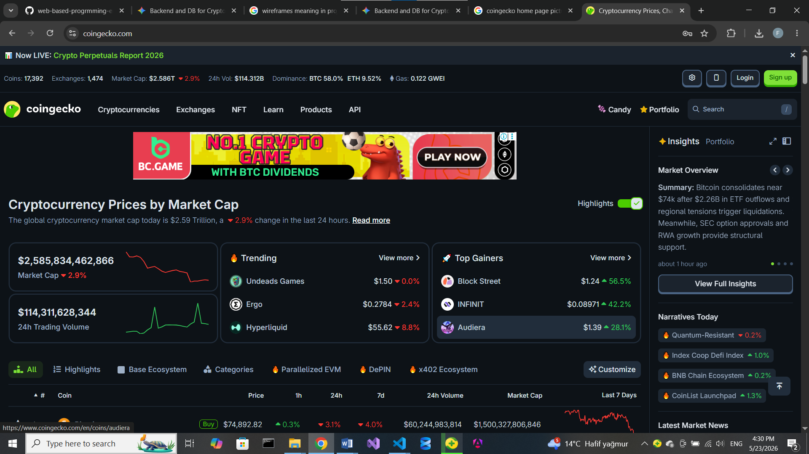

#### Rakip 2: CoinMarketCap

- **URL:** https://coinmarketcap.com
- **Kuruluş:** 2013
- **Kullanıcı tabanı:** Çok geniş (tahmini milyonlar)
- **Fiyatlandırma:** Ücretsiz + ücretli API
- **Güçlü yönler:**
  1. Referans piyasa kaynağı, yüksek bilinirlik
  2. Geniş veri ve sıralamalar
  3. Mobil uygulama
- **Zayıf yönler:**
  1. Reklam yoğun arayüz
  2. Gelişmiş alarm/push deneyimi öne çıkmıyor
  3. Kişiselleştirme sınırlı

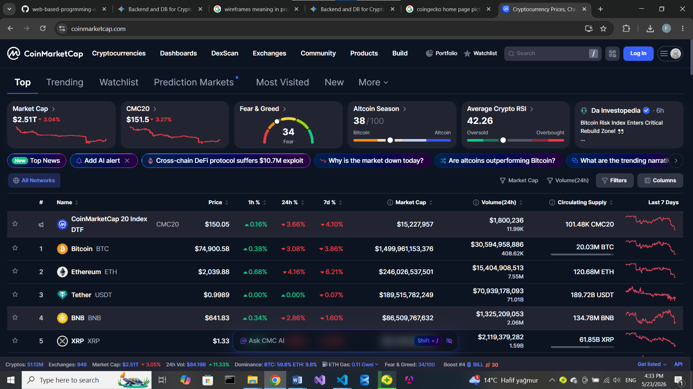

#### Rakip 3: Delta / Blockfolio tarzı portföy uygulamaları

- **URL:** https://delta.app
- **Kuruluş:** ~2017
- **Kullanıcı tabanı:** Geniş (kamuya açık güncel sayı yok)
- **Fiyatlandırma:** Ücretsiz + premium abonelik
- **Güçlü yönler:**
  1. Güçlü portföy takibi ve bildirim
  2. Çoklu borsa entegrasyonu
  3. Olgun mobil deneyim
- **Zayıf yönler:**
  1. Mobil odaklı; kurulabilir hafif web (PWA) zayıf
  2. Gelişmiş özellikler premium ardında
  3. Sade/odaklı tek ekran deneyimi değil

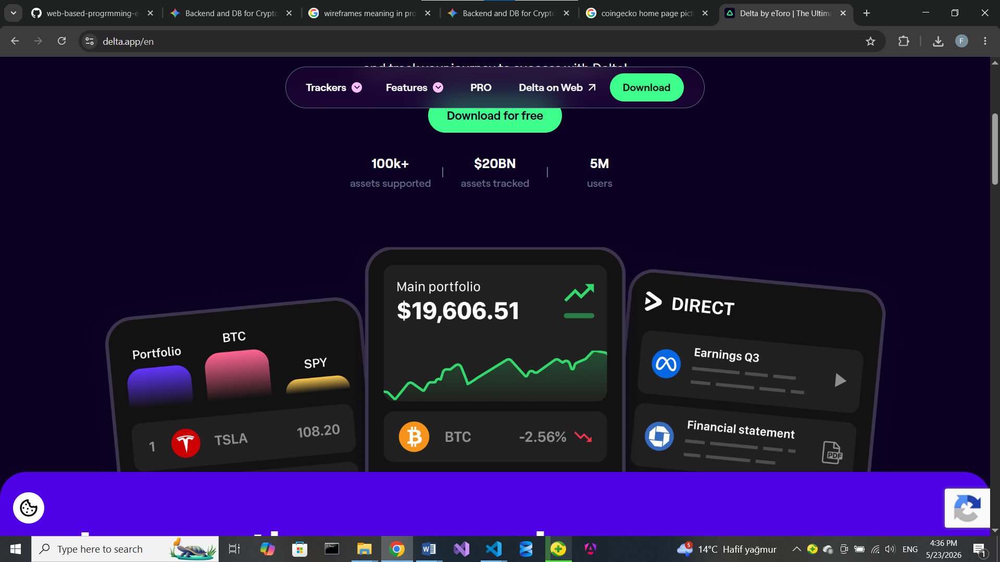

### 6.4 SWOT Analizi

```
┌────────────────────────────────────┬────────────────────────────────────┐
│ GÜÇLÜ YÖNLER (Strengths)            │ ZAYIF YÖNLER (Weaknesses)          │
│ - Sade, reklamsız, hızlı UI         │ - Tek geliştirici / ders ölçeği    │
│ - Sunucu alarm + web-push           │ - Native mobil app yok (V2)        │
│ - PWA + TR/EN + çoklu para birimi   │ - Marka/bilinirlik düşük           │
├────────────────────────────────────┼────────────────────────────────────┤
│ FIRSATLAR (Opportunities)           │ TEHDİTLER (Threats)                │
│ - Reklam yorgunu kullanıcı kitlesi  │ - 3. parti API limit/erişim engeli │
│ - PWA ile uygulama-benzeri dağıtım  │ - Büyük oyuncuların ücretsiz gücü  │
│ - Niş, odaklı konumlandırma         │ - Kripto piyasası volatilitesi     │
└────────────────────────────────────┴────────────────────────────────────┘
```

### 6.5 Positioning Statement

> **FOR** kriptoda küçük/orta pozisyonu olan bireysel yatırımcılar  
> **WHO** varlıklarını dağınık şekilde takip etmekten ve fiyatı kaçırmaktan yorulmuş  
> **OUR PRODUCT IS A** sade, gerçek zamanlı kripto izleme ve alarm panelidir  
> **THAT** fiyat, watchlist, portföy P&L ve push alarmı tek ekranda toplar  
> **UNLIKE** CoinGecko/CoinMarketCap gibi reklam yoğun referans siteleri  
> **OUR PRODUCT** reklamsız, kişisel ve kurulabilir (PWA) bir deneyim sunar.

---

## 7. Teknoloji Yığını (Tech Stack)

### 7.1 Özet Tablo

| Katman | Teknoloji | Versiyon | Rol |
|--------|-----------|----------|-----|
| Frontend framework | Angular | 17.3 | UI render, SPA |
| Styling | Tailwind CSS + Angular Material | 3.4 / 17.3 | Utility-first CSS + bileşenler |
| State management | Servis-tabanlı (Angular signals + RxJS) | RxJS 7.8 | Reaktif durum yönetimi |
| Backend | NestJS (Node.js 20) | 11.x | API + iş mantığı |
| Database | PostgreSQL (Prisma ORM) | 16 / Prisma 5.22 | Kalıcı depolama |
| Cache | Redis | 7 | Piyasa snapshot önbelleği |
| Queue / Jobs | `@nestjs/schedule` (cron/interval) | 6.x | Snapshot + alarm değerlendirme |
| Auth | Argon2 + JWT (Passport) | argon2 0.44 / JWT | Kimlik doğrulama |
| File storage | — (kullanıcı dosyası yok) | — | Kapsam dışı |
| Email | — (transactional email yok) | — | Kapsam dışı (V2) |
| Payment | — (ücretsiz V1) | — | Kapsam dışı |
| Analytics | — | — | Kapsam dışı |
| Error tracking | Sentry (planlı) | — | Hata izleme |
| Hosting (FE) | Vercel | — | Statik/SPA hosting |
| Hosting (BE) | Railway | — | API + cron |
| CI/CD | GitHub Actions | — | Lint, test, build, OpenAPI drift |

### 7.2 Her Teknoloji İçin Detay

> Her teknoloji için aşağıdaki şablonu doldurun.  
> Minimum: proje adında geçen tüm teknolojiler + seçtiğiniz ek'ler.

---

#### 7.2.1 Angular 17 (standalone components, signals)

- **Ne?** Bileşen tabanlı, TypeScript-first SPA frontend framework.
- **Kategori:** Frontend framework
- **Neden seçildi (PROJEMİZE ÖZEL):**
  1. Ders kapsamı doğrudan Angular + RxJS reaktif programlamayı hedefliyor.
  2. Standalone component + signals ile NgModule yükü olmadan modern, yalın yapı.
  3. Router lazy-load ile her özellik ayrı bundle (markets, portfolio, alerts...).
- **Temel özellikler:**
  - Standalone components, `loadComponent` ile route bazlı lazy-load
  - Signals + RxJS interop ile reaktif durum
  - Dependency injection, guard/interceptor mimarisi
  - Angular Material + Tailwind ile UI
  - `@angular/service-worker` ile PWA
  - i18n (TR/EN) build
- **Projedeki rolü:** Tüm SPA; `core/` (servis, guard, interceptor), `features/` (markets, coin-detail, watchlist, portfolio, alerts, news, settings, shell), `shared/`.
- **Alternatifler ve neden seçilmedi:**
  - React: ders Angular odaklı; reaktif state için RxJS entegrasyonu Angular'da daha doğal.
  - Vue: ekosistem/ders uyumu Angular lehine.
- **Trade-off'lar:** Öğrenme eğrisi dik, bundle başlangıç boyutu büyük (lazy-load ile azaltıldı).
- **Öğrenme kaynakları:** angular.dev (resmi), Angular signals rehberi, RxJS docs.

---

#### 7.2.2 RxJS 7 (Observable, Subject, operators)

- **Ne?** Reaktif programlama kütüphanesi; asenkron veri akışlarını Observable ile yönetir.
- **Kategori:** Reaktiflik / state
- **Neden seçildi (PROJEMİZE ÖZEL):**
  1. Canlı fiyat akışı (WebSocket) doğal olarak stream; RxJS ile birleştirme/filtreleme.
  2. Angular ile yerleşik entegrasyon (HttpClient, async pipe, signals interop).
  3. Ders öğrenme hedefi: Observable, Subject, operatörler.
- **Temel özellikler:**
  - Observable/Subject/BehaviorSubject
  - `map`, `filter`, `switchMap`, `combineLatest`, `debounceTime`, `retry`
  - WebSocket fiyat akışını UI sinyallerine bağlama
- **Projedeki rolü:** Fiyat stream servisi, market API çağrıları, alarm/portföy reaktif güncellemeleri.
- **Alternatifler:** Sade Promise/async — çoklu canlı akış birleştirmede yetersiz; NgRx — bu ölçekte gereksiz ağırlık.
- **Trade-off'lar:** Operatör zinciri öğrenme eğrisi; yanlış unsubscribe → memory leak (takeUntil/async pipe ile yönetildi).
- **Öğrenme kaynakları:** rxjs.dev, Angular RxJS rehberi.

---

#### 7.2.3 ApexCharts (`ng-apexcharts`)

- **Ne?** İnteraktif grafik kütüphanesi ve Angular sarmalayıcısı.
- **Kategori:** Veri görselleştirme
- **Neden seçildi (PROJEMİZE ÖZEL):**
  1. Mum (candlestick), çizgi ve area grafiklerini tek kütüphanede sunar.
  2. Zoom/pan, crosshair, tooltip gibi etkileşimler hazır.
  3. Angular wrapper ile bileşen entegrasyonu kolay.
- **Temel özellikler:** Candlestick/line/area, çoklu zaman aralığı, pinch-to-zoom, crosshair, responsive.
- **Projedeki rolü:** `coin-detail` fiyat grafiği (1H/1D/1W/1M/YTD).
- **Alternatifler:** Chart.js — finansal mum grafiği için ek eklenti gerekir; TradingView — ağır/lisans.
- **Trade-off'lar:** Bundle boyutu; lazy-load edilen coin-detail route'unda izole edildi.
- **Öğrenme kaynakları:** apexcharts.com, ng-apexcharts docs.

---

#### 7.2.4 NestJS 11

- **Ne?** Node.js için modüler, TypeScript-first backend framework.
- **Kategori:** Backend framework
- **Neden seçildi:** Modül/DI mimarisi, guard/interceptor/pipe yapısı, `@nestjs/swagger` ile otomatik OpenAPI, `@nestjs/schedule` ile cron.
- **Projedeki rolü:** Tüm REST API + WebSocket proxy + alarm/snapshot zamanlayıcıları.
- **Alternatifler:** Express (yalın ama yapı/standart az), Fastify-only (DI/modül ekosistemi zayıf).
- **Trade-off'lar:** Soyutlama katmanı yeni başlayan için fazladan kavram.
- **Öğrenme kaynakları:** docs.nestjs.com.

---

#### 7.2.5 Prisma 5 + PostgreSQL 16

- **Ne?** Tip güvenli ORM ve ilişkisel veritabanı.
- **Kategori:** ORM / Database
- **Neden seçildi:** Tip güvenli sorgu, migration yönetimi, ilişkiler ve cascade silme (KVKK hesap silme), PostgreSQL güvenilirliği.
- **Projedeki rolü:** User, RefreshToken, WatchlistItem, PortfolioPosition, PriceAlert, PushSubscription, UserSettings, AuditLog modelleri.
- **Alternatifler:** TypeORM (tip güvenliği zayıf), Drizzle (ekosistem yeni).
- **Trade-off'lar:** Prisma engine boyutu; Docker imajına `prisma generate` adımı eklendi.
- **Öğrenme kaynakları:** prisma.io/docs, PostgreSQL docs.

### 7.3 Reddedilen Teknoloji Kararları

Düşünüp **seçmediğiniz** teknolojiler — neden?

| Aday | Kategori | Neden seçmedik |
|------|----------|----------------|
| NgRx (Store) | State management | Servis + signals + RxJS bu ölçek için yeterli; boilerplate fazla |
| Chart.js | Grafik | Finansal mum grafiği için ek eklenti gerekir; ApexCharts hazır |
| Firebase/Supabase | Backend/DB | Ders kapsamı kendi NestJS + Prisma API'sini gerektiriyor |
| Socket.IO | Realtime | Binance ham WS yeterli; sunucu `ws` proxy daha hafif |
| TypeORM | ORM | Prisma tip güvenliği ve migration deneyimi daha iyi |

### 7.4 Tech Stack Mimari Kararı (ADR Özeti)

- **ADR-001:** Veritabanı olarak PostgreSQL + Prisma — tip güvenliği,
  migration ve ilişkisel bütünlük (cascade silme KVKK için kritik).
- **ADR-002:** Binance fiyat akışı için sunucu tarafı `ws` proxy gateway —
  tarayıcının coğrafi engele (HTTP 451) takılmaması ve tek bağlantının
  paylaşılması.
- **ADR-003:** Kimlik doğrulamada Argon2 + kısa ömürlü **Bearer access
  token (yanıt gövdesi)** + **httpOnly `refresh_token` cookie** (rotasyon,
  `logout-all` ile anlık iptal). Access token cookie olmadığı için
  yapısal CSRF güvenliği (`csurf` kaldırıldı); refresh uzun ömürlü sırrı
  JS'den izole eder.

> Ayrıntılı ADR'lar: [repo/docs/adr/ADR-007-threat-model.md](repo/docs/adr/ADR-007-threat-model.md)

---

## 8. Sistem Mimarisi

### 8.1 Yüksek Seviye Mimari (C4 — Level 1: Context)

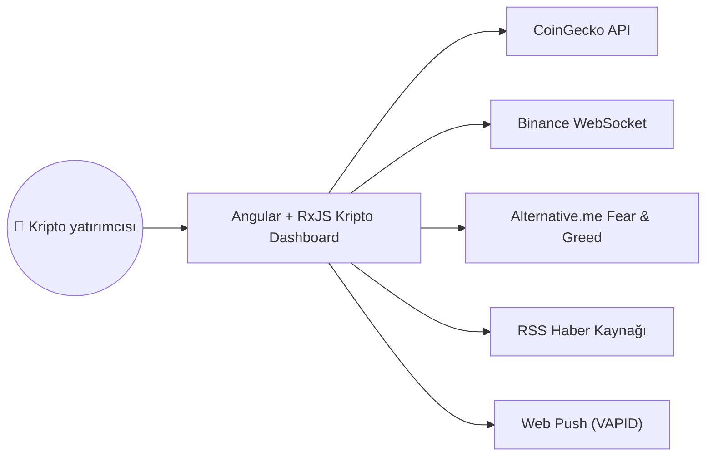

*Ayrıntılı mimari (Türkçe): [repo/docs/diagrams/architecture.md](repo/docs/diagrams/architecture.md).*

### 8.2 Container Seviyesi (C4 — Level 2)

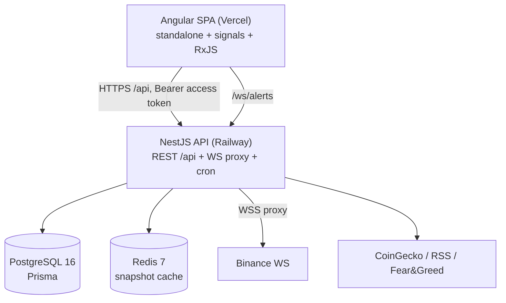

*Container diyagramı; ayrıntı (Türkçe): [repo/docs/diagrams/architecture.md](repo/docs/diagrams/architecture.md).*

### 8.3 Önemli Akışlar (Sequence Diagrams)

#### 8.3.1 Akış — Kullanıcı Kaydı

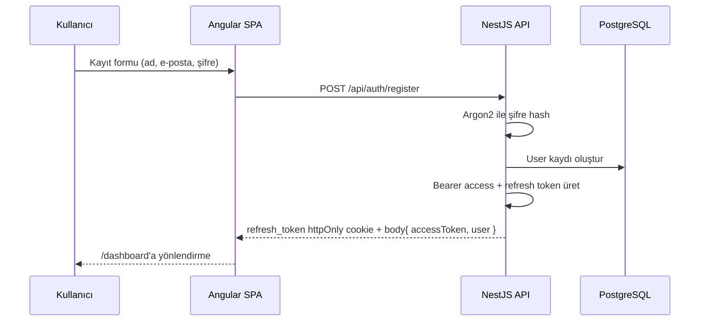

#### 8.3.2 Akış — Fiyat Alarmı Tetikleme

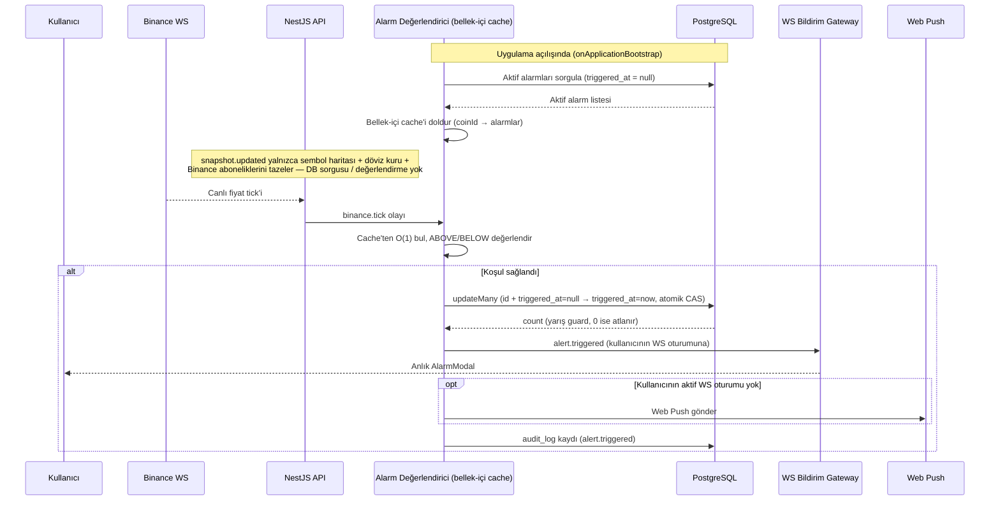

### 8.4 Deployment Topology

Production'da frontend Vercel CDN üzerinden statik servis edilir; API
Railway'de çalışır ve PostgreSQL + Redis'e bağlanır; canlı fiyat için
Railway'deki API Binance WS'e proxy kurar.

```
┌─────────────────┐     ┌─────────────────┐     ┌─────────────────┐
│  Tarayıcı (PWA) │────►│  Vercel (FE)    │     │  PostgreSQL 16  │
└─────────────────┘     └────────┬────────┘     │  (Prisma)       │
        │                        │              │                 │
        │   /api (HTTPS,         ▼              └────────▲────────┘
        │   httpOnly cookie)  ┌─────────────────┐         │
        └────────────────────►│  Railway (API)  │─────────┘
                              │  REST + WS +    │
                              │  cron/alarm     │────────┐
                              └────────┬────────┘        ▼
                                  │            ┌─────────────────┐
                       WSS proxy  ▼            │   Redis 7       │
                        ┌─────────────────┐    │ (snapshot cache)│
                        │ Binance WebSocket│    └─────────────────┘
                        └─────────────────┘
```

### 8.5 Mimari Kararlar (ADR'lar)

En az **3 ADR** yazın. Her biri `ADR-00X-[kısa-ad].md` formatında repo'nuzda uygun bir `docs/adr/` alt klasöründe ayrı dosya:

- **ADR-001:** PostgreSQL + Prisma seçimi — tip güvenli sorgu, migration,
  ilişkisel bütünlük ve cascade silme (KVKK hesap silme akışı).
- **ADR-002:** Sunucu tarafı Binance WS proxy gateway — tarayıcı coğrafi
  engelini (HTTP 451) aşmak, tek bağlantıyı paylaşmak, reconnect yönetimi.
- **ADR-003:** Argon2 + **Bearer access token (yanıt gövdesi)** +
  **httpOnly `refresh_token` cookie** (rotasyon, `logout-all` anlık iptal).
  `csurf` kaldırıldı; CSRF koruması yapısal (access cookie değil) + CORS
  pin + `SameSite`. XSS'e karşı uzun ömürlü sır JS'den izole.

> Ayrıntılı kayıtlar `repo/docs/adr/` altında (örn. tehdit modeli:
> `ADR-007-threat-model.md`).

### 8.6 Katlama / Ölçekleme Planı

| Kullanıcı yükü | Aksiyon |
|----------------|---------|
| 0 - 1K MAU | MVP altyapısı yeter |
| 1K - 10K | Read replica, CDN önceliği, Redis cache |
| 10K - 100K | Mikroservise ayrıştırma, queue, horizontal scale |
| 100K+ | Multi-region, sharding |

---

## 9. Veri Modeli ve API Tasarımı

### 9.1 ER Diyagram

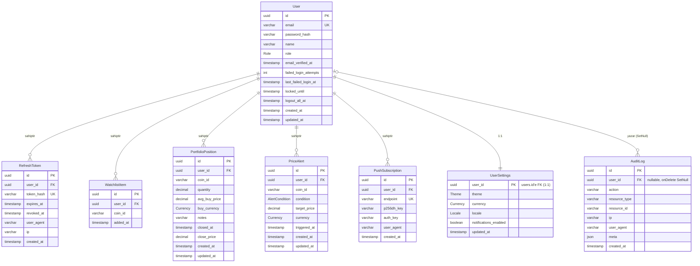

**Enum'lar:** `Role` = USER · ADMIN | `AlertCondition` = ABOVE · BELOW |
`Currency` = USD · EUR · TRY | `Theme` = LIGHT · DARK · SYSTEM |
`Locale` = TR · EN.

**Index / benzersizlik kısıtları:** `users.email` UNIQUE ·
`refresh_tokens.token_hash` UNIQUE + index `(user_id, revoked_at)` ·
`watchlist_items` UNIQUE `(user_id, coin_id)` ·
`portfolio_positions` index `(user_id, closed_at)` ·
`price_alerts` index `(user_id, triggered_at)` + `(triggered_at)` ·
`push_subscriptions.endpoint` UNIQUE + index `(user_id)` ·
`audit_log` index `(user_id, created_at)` + `(action, created_at)`.
Tüm `user_id` yabancı anahtarları `onDelete: Cascade`'tir
(`audit_log` hariç — `SetNull`, denetim izi kullanıcı silinse de kalır).

*Kaynak: [repo/backend/prisma/schema.prisma](repo/backend/prisma/schema.prisma)
· Ayrıntılı ERD: [repo/docs/diagrams/erd.md](repo/docs/diagrams/erd.md)*

### 9.2 Tablolar (Ayrıntılı)

#### Table: `users`

| Kolon | Tip | Null? | Default | Index | Açıklama |
|-------|-----|-------|---------|-------|----------|
| id | UUID | ❌ | uuid() | PK | |
| email | VARCHAR(255) | ❌ | — | UNIQUE | E-posta |
| password_hash | VARCHAR(255) | ❌ | — | — | **Argon2** hash |
| name | VARCHAR(100) | ❌ | — | — | |
| role | Role (enum) | ❌ | USER | — | USER / ADMIN |
| email_verified_at | TIMESTAMPTZ | ✅ | NULL | — | |
| failed_login_attempts | INT | ❌ | 0 | — | Brute-force koruması |
| last_failed_login_at | TIMESTAMPTZ | ✅ | NULL | — | |
| locked_until | TIMESTAMPTZ | ✅ | NULL | — | Geçici kilit |
| logout_all_at | TIMESTAMPTZ | ✅ | NULL | — | Tüm oturumları geçersiz kıl |
| created_at | TIMESTAMPTZ | ❌ | NOW() | — | |
| updated_at | TIMESTAMPTZ | ❌ | NOW() | — | `@updatedAt` |

#### Table: `portfolio_positions`

| Kolon | Tip | Null? | Default | Index | Açıklama |
|-------|-----|-------|---------|-------|----------|
| id | UUID | ❌ | uuid() | PK | |
| user_id | UUID | ❌ | — | (user_id, closed_at) | FK → users (cascade) |
| coin_id | VARCHAR(100) | ❌ | — | — | CoinGecko coin id |
| quantity | DECIMAL(24,8) | ❌ | — | — | Adet |
| avg_buy_price | DECIMAL(18,2) | ❌ | — | — | Ortalama alış |
| buy_currency | Currency (enum) | ❌ | — | — | USD/EUR/TRY |
| notes | VARCHAR(500) | ✅ | NULL | — | |
| closed_at | TIMESTAMPTZ | ✅ | NULL | — | Pozisyon kapanışı |
| close_price | DECIMAL(18,2) | ✅ | NULL | — | |
| created_at / updated_at | TIMESTAMPTZ | ❌ | NOW() | — | |

#### Table: `price_alerts`

| Kolon | Tip | Null? | Default | Index | Açıklama |
|-------|-----|-------|---------|-------|----------|
| id | UUID | ❌ | uuid() | PK | |
| user_id | UUID | ❌ | — | (user_id, triggered_at) | FK → users (cascade) |
| coin_id | VARCHAR(100) | ❌ | — | — | |
| condition | AlertCondition (enum) | ❌ | — | — | ABOVE / BELOW |
| target_price | DECIMAL(18,2) | ❌ | — | — | |
| currency | Currency (enum) | ❌ | — | — | |
| triggered_at | TIMESTAMPTZ | ✅ | NULL | (triggered_at) | Tetiklenme zamanı |
| created_at / updated_at | TIMESTAMPTZ | ❌ | NOW() | — | |

> Diğer tablolar: `refresh_tokens`, `watchlist_items` (unique
> `user_id+coin_id`), `push_subscriptions`, `user_settings`,
> `audit_log`. Tam tanım: `repo/backend/prisma/schema.prisma`.

### 9.3 Index Stratejisi

| Tablo | Index | Amaç |
|-------|-------|------|
| users | email (unique) | Login hızlı |
| refresh_tokens | token_hash (unique), (user_id, revoked_at) | Token doğrulama/iptal |
| watchlist_items | (user_id, coin_id) unique | Çift kayıt engeli + listeleme |
| portfolio_positions | (user_id, closed_at) | Açık/kapalı pozisyon listeleme |
| price_alerts | (user_id, triggered_at), (triggered_at) | Aktif alarm değerlendirme |
| push_subscriptions | endpoint (unique), (user_id) | Push gönderimi |
| audit_log | (user_id, created_at), (action, created_at) | Denetim sorguları |

### 9.4 API Tasarımı

#### 9.4.1 Authentication

**POST** `/api/auth/register`

Request:
```json
{ "email": "user@example.com", "password": "secret123", "name": "Ali" }
```

Response 201:
```json
{ "user": { "id": "uuid", "email": "...", "name": "Ali" }, "access_token": "...", "refresh_token": "..." }
```

Errors: 400 (validation), 409 (email exists)

---

**POST** `/api/auth/login` — aynı gövde. Başarılı yanıtta **kısa ömürlü
access token (15 dk) yanıt gövdesinde** döner ve istemci tarafında
tutulur; **yalnızca `refresh_token` httpOnly cookie** olarak set edilir
(prod/cross-site'ta `Secure`+`SameSite=None`, yerel geliştirmede
`SameSite=Lax`). Diğer auth uçları: `POST /api/auth/refresh`,
`POST /api/auth/logout`, `POST /api/auth/logout-all`, `GET /api/auth/me`.

> Not: Korumalı uçlar `Authorization: Bearer <access token>` ile
> doğrulanır. Access token cookie olmadığı için tarayıcı onu cross-site
> otomatik göndermez — bu yapısal CSRF korumasıdır (eski `csurf`
> double-submit kaldırıldı; prod cross-origin POST'larını bozuyordu).
> Tek cookie-auth uç olan `/auth/refresh`, token rotasyonu + CORS
> allowlist (`FRONTEND_ORIGIN`) + `SameSite` cookie ile korunur.

---

#### 9.4.2 Kaynak Uçları (gerçek endpoint'ler)

**Watchlist**
- `GET /api/watchlist` — kullanıcının takip listesi
- `POST /api/watchlist` — `{ coinId }` ekle
- `DELETE /api/watchlist/:coinId` — çıkar

**Portfolio**
- `GET /api/portfolio` — pozisyonlar + P&L
- `POST /api/portfolio` — pozisyon oluştur
- `PATCH /api/portfolio/:id` — güncelle
- `POST /api/portfolio/:id/close` — pozisyon kapat
- `DELETE /api/portfolio/:id` — sil

**Alerts**
- `GET /api/alerts` · `POST /api/alerts` · `PATCH /api/alerts/:id` · `DELETE /api/alerts/:id`

**Market** (genel veri)
- `GET /api/market/top` — top‑100 snapshot
- `GET /api/market/coin/:id` · `GET /api/market/chart/:id` · `GET /api/market/ohlc/:symbol`
- `GET /api/market/news` · `GET /api/market/sentiment` · `GET /api/market/exchange-rates`

**Hesap / Ayarlar**
- `GET /api/me` · `GET /api/me/export` (KVKK veri export) · hesap silme
- `GET /api/settings` · `PATCH /api/settings`

**Push & Health**
- `POST /api/push/subscribe` · `GET /api/push/vapid-public-key`
- `GET /api/health`

Hata kodları: 400 (validation), 401 (auth), 403 (yetki), 404,
409 (çakışma), 429 (rate limit). Toplam ~35 işlem; tam şema için
[repo/docs/openapi.yaml](repo/docs/openapi.yaml).

### 9.5 OpenAPI Spec

Spec `@nestjs/swagger` ile otomatik üretilir ve repoda
`repo/docs/openapi.yaml` (+ `openapi.json`) olarak tutulur. CI, controller/DTO
değişip spec güncellenmediğinde `git diff --exit-code` ile **drift
kontrolü** yapar. Geliştirmede Swagger UI: `http://localhost:3000/api/docs`.

### 9.6 Rate Limiting Politikası

| Endpoint grubu | Limit (gerçek `@nestjs/throttler` ayarı) |
|----------------|------------------------------------------|
| Auth — `POST /api/auth/login`, `/register` | 5 istek / 60 sn |
| Genel API (default throttler) | 100 istek / 60 sn |
| Hesap kilidi (brute-force) | 15 dk içinde 10 başarısız giriş → hesap 15 dk kilitli (429) |

---

## 10. UI/UX Tasarımı

### 10.1 Bilgi Mimarisi (Sitemap)

```
/login                 (publicOnlyGuard)
/register              (publicOnlyGuard)
/  (shell, authGuard)
├── /dashboard         (varsayılan — özet + sentiment)
├── /markets           (top-100 canlı tablo)
├── /coin/:id          (detay + grafik)
├── /watchlist
├── /portfolio
├── /alerts
├── /news
└── /settings          (tema / dil / para birimi / hesap)
/**                    (404 Not Found)
```

### 10.2 User Flow (Ana Akışlar)

#### Akış 1 — İlk Kayıt ve İlk Kullanım

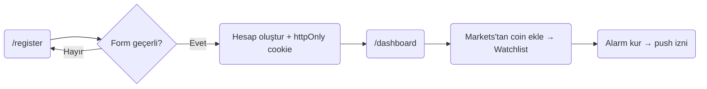

*Not: E-posta doğrulama V1 kapsamında zorunlu değildir; kayıt sonrası
doğrudan dashboard'a geçilir.*

#### Akış 2 — Alarm Tetikleme

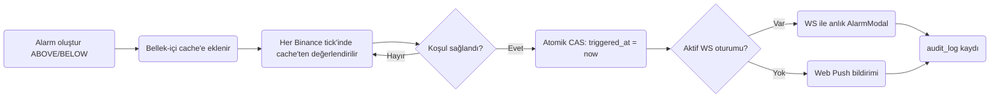

*Tüm kullanıcı akışı diyagramları (Türkçe): [repo/docs/diagrams/user-flow.md](repo/docs/diagrams/user-flow.md).*

### 10.3 Design System

#### Renk Paleti

```
Primary (blue):     #2563eb   (crypto.blue)
Success (yükseliş):  #10b981   (crypto.green)
Danger  (düşüş):     #ef4444   (crypto.red)
Dark bg:             #0f1117   (crypto.dark-bg)
Dark surface:        #1a1f2e   (crypto.dark-surface)
Dark border:         #2d3748   (crypto.dark-border)
```

> Kaynak: `repo/frontend/tailwind.config.js` (`darkMode: 'class'`,
> `theme.extend.colors.crypto`). Nötr griler ve bileşen renkleri Tailwind
> + Angular Material temasından gelir.

#### Tipografi

| Seviye | Boyut / Line-height / Ağırlık |
|--------|-------------------------------|
| H1 | 36/1.2/700 |
| H2 | 30/1.3/600 |
| H3 | 24/1.4/600 |
| Body | 16/1.5/400 |
| Caption | 14/1.5/400 |

Font: Sistem/sans-serif gövde fontu; sayısal/teknik alanlarda monospace
(`JetBrains Mono`, `Fira Code`, `Consolas` fallback — tailwind
`font-mono`). Tablo değerleri tipografi hedefi olarak korunmuştur.

#### Spacing

8-point grid: 4, 8, 12, 16, 24, 32, 48, 64, 96, 128 px.

#### Component Kütüphanesi

Angular Material (CDK dahil) + Tailwind CSS 3 utility sınıfları.
Grafikler için ApexCharts (`ng-apexcharts`). Tema light/dark/system,
Tailwind `darkMode: 'class'` ile yönetilir.

### 10.4 Wireframe'ler (Low-Fi)

Düşük sadakatli wireframe seti, uygulamanın temel akışlarını ve geleceğe dönük
ekran ihtiyaçlarını aynı dokümanda toplar:
[repo/docs/design/wireframes.md](repo/docs/design/wireframes.md)

| Gereksinim | Wireframe | Not |
|------------|-----------|-----|
| Landing | [Landing](repo/docs/design/wireframes.md#landing) | Kavramsal pre-login vitrin ekranı; mevcut Angular route'u değildir. |
| Kayıt / Giriş | [Kayıt / Giriş](repo/docs/design/wireframes.md#kayit-giris) | Mevcut `login` ve `register` akışlarının ortak low-fi taslağı. |
| Dashboard (boş) | [Dashboard boş](repo/docs/design/wireframes.md#dashboard-bos) | Empty state ve onboarding mesajları odakta. |
| Dashboard (dolu) | [Dashboard dolu](repo/docs/design/wireframes.md#dashboard-dolu) | Seed verili, widget yoğun ana görünüm. |
| Ana CRUD ekranı | [Portfolio CRUD](repo/docs/design/wireframes.md#ana-crud-ekrani) | Mevcut uygulamada create/update/delete ağırlığı en yüksek akış portföy yönetimidir. |
| Detay sayfası | [Detay sayfası](repo/docs/design/wireframes.md#detay-sayfasi) | Coin detay + grafik + hızlı aksiyonlar. |
| Ayarlar | [Ayarlar](repo/docs/design/wireframes.md#ayarlar) | Tema, dil, para birimi ve KVKK işlemleri. |
| Hata (404, 500) | [Hata ekranları](repo/docs/design/wireframes.md#hata-404-500) | `404` mevcut route fallback'ini, `500` ise gelecekteki tam sayfa hata durumunu temsil eder. |

`Landing` ve `500` ekranları, mevcut ürün sürümünde route olarak bulunmayan ama
ürün kapsamını ve beklenen kullanıcı deneyimini belgelemek için eklenen
kavramsal wireframe'lerdir.

### 10.5 Mockup'lar (Hi-Fi)

Çalışan uygulamadan alınan yüksek çözünürlüklü ekran görüntüleri
(`repo/docs/screenshots/`):

| Ekran | Görüntü |
|-------|---------|
| Giriş (Login) | 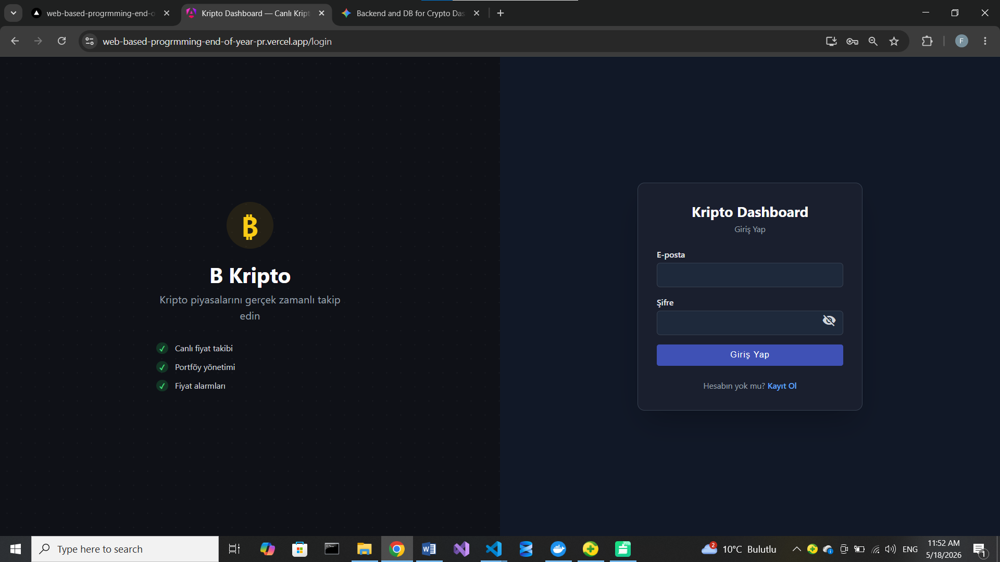 |
| Kayıt (Register) | 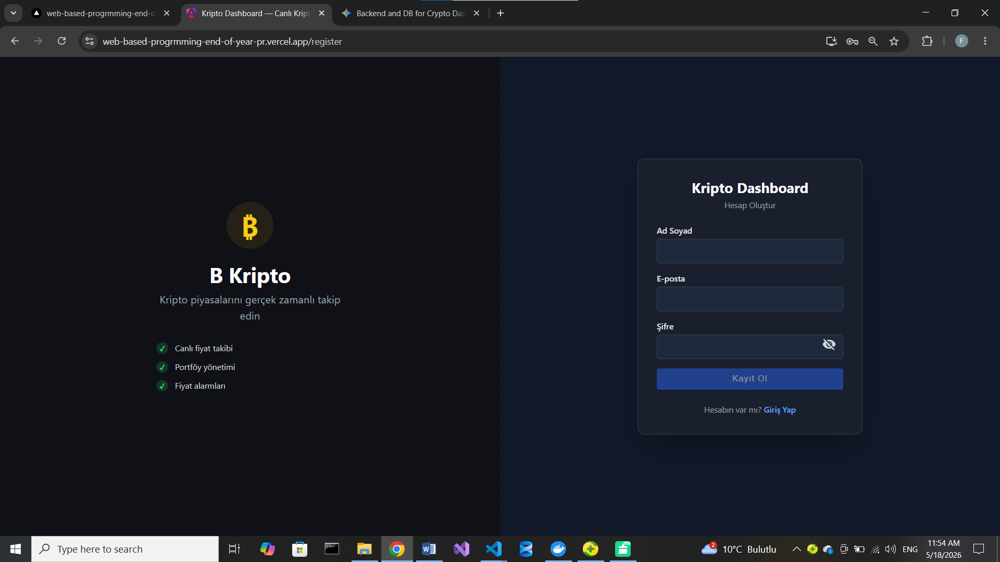 |
| Dashboard — boş (empty state) | 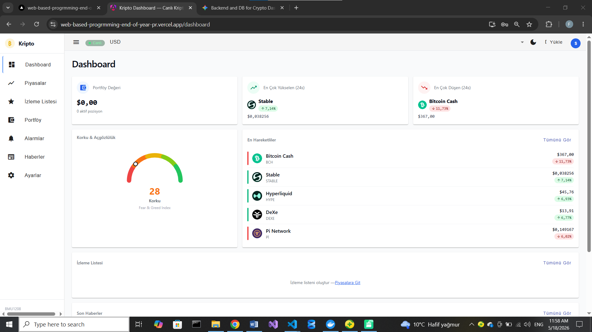 |
| Dashboard — dolu (seed data) | 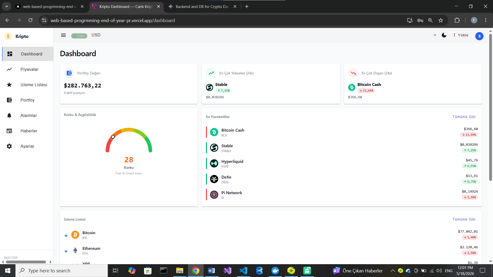 |
| Piyasalar (Markets) | 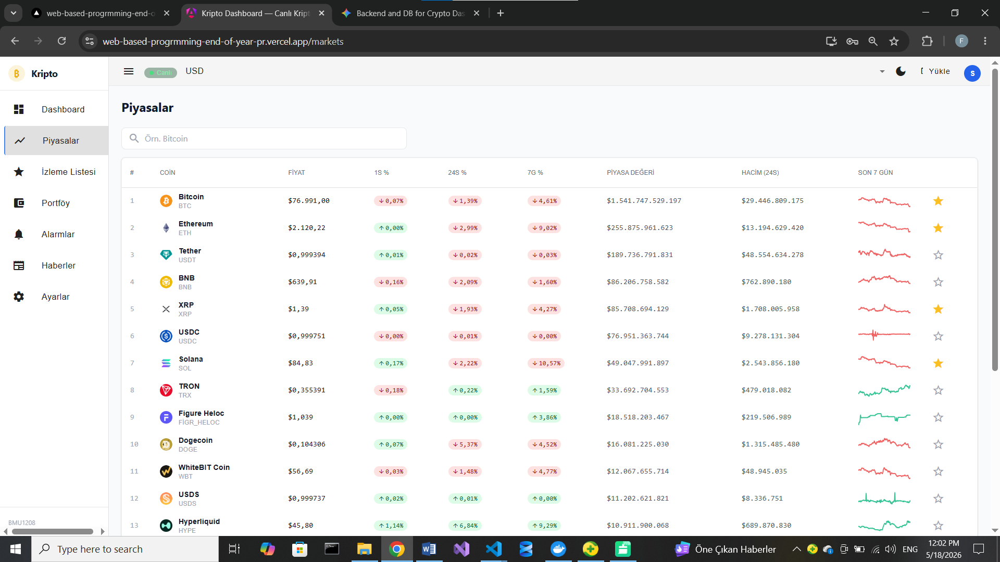 |
| Coin Detay + Grafik | 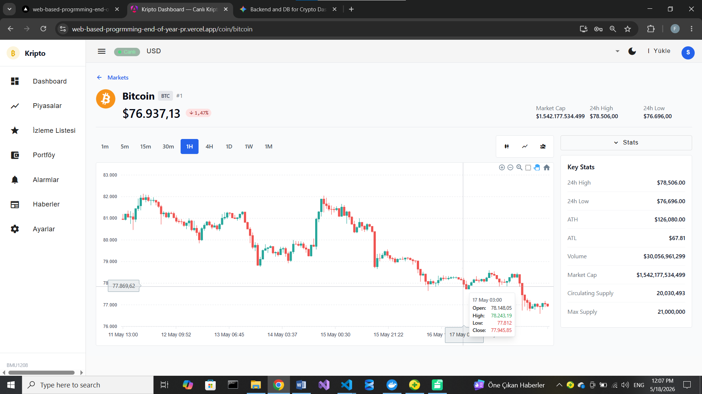 |
| Mobil (responsive) | 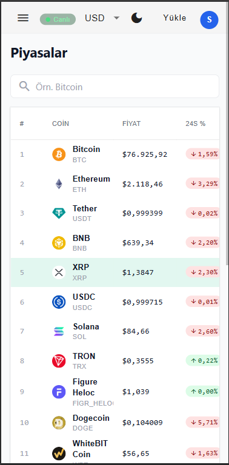 |
| Koyu Mod (dark mode) | 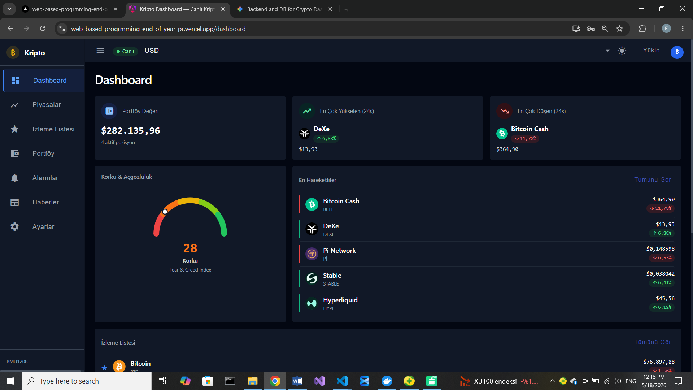 |

🔗 **Figma:** https://www.figma.com/design/I1BTkxBPmg4vhFFGABbeRU/Untitled?node-id=0-1&t=JTCV9GGbatwVjYgF-1

### 10.6 Responsive

| Breakpoint | px | Nelere dikkat |
|------------|-----|---------------|
| Mobile | 375 | Tek kolon, hamburger nav, dokunmatik alan 44×44 px |
| Tablet | 768 | İki kolon, sidebar açılır |
| Desktop | 1280 | Tam layout |

### 10.7 Erişilebilirlik (a11y) Notları

- [ ] Kontrast ≥ 4.5:1 (normal metin), 3:1 (büyük metin)
- [ ] Tab ile her interaktif elemana ulaşılıyor
- [ ] Focus ring görünür
- [ ] Resimlerde alt text
- [ ] Form input'ları `<label>`'lı
- [ ] `aria-live` bölgeleri (toast bildirimleri)
- [ ] `prefers-reduced-motion` respect

Test: Lighthouse ≥ 95, axe DevTools → 0 kritik hata.

### 10.8 Micro-interactions

- Buton hover: 150ms scale(1.02)
- Modal giriş: 300ms ease-out slide-up
- Toast: 400ms → 3s görünür → 400ms fade-out
- Form submit loading: button'a spinner inject

### 10.9 Boş / Yükleniyor / Hata Durumları

| Ekran | Empty | Loading | Error |
|-------|-------|---------|-------|
| Dashboard | "Henüz veri yok — Markets'tan coin ekleyin" | Skeleton kartlar | "Yüklenemedi, tekrar dene" |
| Watchlist | "Takip listen boş — coin ekle" | Skeleton satırlar | Hata mesajı + retry |
| Portfolio | "Pozisyon yok — ilk pozisyonunu ekle" | Skeleton tablo | Hata mesajı + retry |
| Markets | — (her zaman dolu/snapshot) | Skeleton tablo | "Canlı veri yok, snapshot gösteriliyor" |
| Alerts | "Alarm yok — ilk alarmını kur" | Skeleton liste | Hata mesajı + retry |

---

## 11. Güvenlik, Performans, Test

### 11.1 Güvenlik

**Uygulanan kontroller:**

- [x] Şifreler **Argon2id** ile hash'lenir (yapılandırılabilir time/memory cost)
- [x] JWT access (15 dk) + refresh (7 gün) token, refresh **rotasyonu**
- [x] `refresh_token` httpOnly + secure + sameSite cookie (uzun ömürlü sır JS'e açılmaz); access token kısa ömürlü Bearer (istemci belleğinde)
- [x] Rate limit: auth 5/dk, genel API 100/dk (`@nestjs/throttler`)
- [x] Brute-force: 15 dk'da 10 hatalı giriş → 15 dk hesap kilidi
- [x] Input validation: `class-validator` + global `ValidationPipe` (whitelist + forbidNonWhitelisted)
- [x] SQL injection koruma: Prisma parametrized query
- [x] XSS koruma: Angular yerleşik template escape
- [x] CSRF koruma: yapısal — access token cookie değil (tarayıcı cross-site otomatik göndermez) + CORS allowlist + `SameSite` refresh cookie (`csurf` kaldırıldı: prod cross-origin POST'larını bozuyordu)
- [x] `helmet` güvenlik başlıkları
- [x] `.env` gitignore + `.dockerignore`; secret'lar ortam değişkeni / CI secrets
- [x] HTTPS zorunlu (prod — Vercel/Railway)
- [x] KVKK: veri export (`/api/me/export`) + hesap silme (cascade)
- [x] Denetim kaydı (`audit_log`): giriş, kilit, hesap işlemleri
- [ ] Gizlilik politikası sayfası (V2)
- [ ] 2FA (V2)

**OWASP Top 10 Tablosu:**

| # | Risk | Uygulamam |
|---|------|-----------|
| A01 | Broken Access Control | Her endpoint authz middleware |
| A02 | Crypto Failures | TLS (prod), **Argon2id**, env secrets, httpOnly JWT |
| A03 | Injection | Parametrized queries, input validation |
| A04 | Insecure Design | Threat modeling STRIDE |
| A05 | Misconfig | Helmet middleware, securityheaders A+ |
| A06 | Vulnerable Components | Dependabot, `npm audit` haftalık |
| A07 | Auth Failures | Rate limit + hesap kilidi, refresh rotasyonu, logout-all (2FA → V2) |
| A08 | Software Integrity | Lock files, signed commits |
| A09 | Logging | Sentry, structured logs |
| A10 | SSRF | URL whitelist, internal IP deny |

### 11.2 Performans

**Hedefler:**

| Metrik | Hedef | Ölçüm aracı |
|--------|-------|-------------|
| LCP (Largest Contentful Paint) | < 2.5s | Lighthouse, Web Vitals |
| INP (Interaction to Next Paint) | < 200ms | Web Vitals |
| CLS (Cumulative Layout Shift) | < 0.1 | Web Vitals |
| API P95 | < 500ms | Sentry Performance |
| Bundle size (gzipped) | < 200 KB | webpack-bundle-analyzer |

**Optimizasyonlar:**

- [x] Code splitting + tree shaking (Angular production build)
- [x] Route-based lazy loading (`loadComponent` her feature için)
- [x] Redis cache (CoinGecko piyasa snapshot, TTL'li)
- [x] DB index optimization (Prisma şemasında bileşik index'ler)
- [x] N+1 query önleme (Prisma `include`/tek sorgu)
- [x] CDN + Gzip/Brotli (Vercel statik dağıtım) · service worker cache (PWA)
- [—] HTTP caching header ince ayarı (Cache-Control/ETag) — *Not: Kripto gibi gerçek zamanlı finansal verilerde "bayat veri" (stale data) gösterim riskini önlemek için API yanıtlarında tarayıcı önbelleklemesi bilinçli olarak es geçilmiş, performans yükü sunucu tarafında Redis ile çözülmüştür.*
- [—] Image optimization — uygulamada kullanıcı görseli yok (N/A)

### 11.3 Test Stratejisi

**Piramit:**

```
         ┌─ E2E (Playwright) ──────────┐
         │  5 happy-path akışı          │  repo/tests/frontend
         ├──────────────────────────────┤
         │ Backend E2E (Jest+Supertest) │  repo/tests/backend
         │  app/auth/users/security/    │  (5 spec dosyası)
         │  openapi                     │
         ├──────────────────────────────┤
         │  Unit (Jest)                 │  *.spec.ts (kaynak yanında)
         │  backend ~21 + frontend ~21  │  + Angular Testing Library
         └──────────────────────────────┘
```

**Coverage hedefi:** %70+ genel, iş mantığı/servislerde daha yüksek.

> **Not (yeni yapı):** Birim `*.spec.ts` dosyaları Angular/Nest geleneği
> gereği kaynak yanında (`*/src/**`) kalır; tüm **e2e** süitleri
> `repo/tests/{backend,frontend}` altına taşınmış ve Jest/Playwright
> yapılandırmaları buna göre güncellenmiştir.

**Çalıştırma:**
```bash
# Backend (PostgreSQL + Redis ayakta olmalı)
cd repo/backend && npm test && npm run test:e2e
# Frontend unit
cd repo/frontend && npm run test:ci
# Frontend e2e (backend + frontend çalışır durumda)
cd repo/frontend && npm run test:e2e
```

**CI'da:** Her push/PR'da lint + birim/coverage + backend e2e + build
+ OpenAPI drift (backend), lint + birim/coverage + build + Lighthouse
(frontend).

---

## 12. Maliyet, Gelir Modeli, GTM

### 12.1 Business Model Canvas

| Blok | İçerik |
|------|--------|
| **Customer Segments** | Bireysel kripto yatırımcıları (birincil); kriptoya yeni başlayanlar (ikincil) |
| **Value Propositions** | Reklamsız tek ekran izleme; sunucu alarm + push; PWA + TR/EN + çoklu para birimi |
| **Channels** | SEO/içerik, kripto toplulukları (Reddit/Discord/X), ürün avı (Product Hunt), öğrenci ağı |
| **Customer Relationships** | Self-service; topluluk + GitHub issue geri bildirimi |
| **Revenue Streams** | Freemium (ücretsiz çekirdek + ileride Pro abonelik) |
| **Key Resources** | Geliştirici zamanı, 3. parti API rate limitleri (özellikle CoinGecko/Binance), hosting |
| **Key Activities** | Platform geliştirme, güvenilirlik/uptime, veri entegrasyonu |
| **Key Partners** | Vercel, Railway, CoinGecko, Binance, Alternative.me |
| **Cost Structure** | Hosting + DB/Redis + domain; (V1'de marketing ~0, organik) |

### 12.2 Gelir Modeli

**Seçtiğimiz model:** Freemium (V1 tamamen ücretsiz; Pro plan V2 fikri).

**Neden bu model?** Niş bir izleme aracında erişim engeli düşük tutulmalı;
kullanıcı önce değeri görmeli. Gelir, gelişmiş alarm/limit gibi güç
özelliklerinde Pro abonelik ile sağlanabilir. (Ders projesi: gelir
modeli illüstratiftir.)

**Fiyat tablosu (illüstratif):**

| Plan | Fiyat | İçerik |
|------|-------|--------|
| Free | ₺0 | Watchlist, portföy, sınırlı sayıda alarm, temel grafik |
| Pro | ~₺79/ay | Sınırsız alarm, çoklu cihaz push, gelişmiş grafik/aralık |
| Business | ~₺199/ay | Pro + API erişimi, öncelikli destek (V2+) |

**Annual discount:** Yıllık ödemede 2 ay bedava.

**Rakip fiyat kıyaslaması:**

| Rakip | Giriş | Pro | Business |
|-------|-------|-----|----------|
| CoinGecko | ₺0 (reklamlı) | API ücretli planlar | Kurumsal API |
| Delta | ₺0 | ~₺60–120/ay (premium) | — |
| **Biz** | ₺0 | ~₺79/ay (V2 fikri) | ~₺199/ay (V2+) |

### 12.3 Maliyet Tahmini

#### 12.3.1 Tek Seferlik Geliştirme (freelance karşılığı)

- Tahmini adam-saat: **~180** saat (tasarım + full-stack geliştirme + test + deploy)
- Saatlik ücret (junior): ₺400
- **Toplam geliştirme:** **~₺72.000** (freelance karşılığı, illüstratif)

#### 12.3.2 Aylık Altyapı — MVP

| Bileşen | Sağlayıcı | Aylık |
|---------|-----------|-------|
| Frontend hosting | Vercel | ₺0 (free/hobby) |
| Backend | Railway | ₺0–~₺200 (kullanım bazlı) |
| Veritabanı | PostgreSQL (Railway/managed) | ₺0–~₺150 |
| Cache | Redis (Railway/managed) | ₺0–~₺100 |
| Email | — (V1'de yok) | ₺0 |
| Domain | .app / .com | ₺500/yıl ≈ ₺42/ay |
| Error tracking | Sentry free | ₺0 |
| **TOPLAM** | | **~₺50–500/ay** |

#### 12.3.3 Aylık Altyapı — 1K Aktif Kullanıcı

| Bileşen | Aylık |
|---------|-------|
| Backend (Railway, ölçekli) | ~₺400 |
| PostgreSQL | ~₺250 |
| Redis | ~₺150 |
| Domain + Sentry | ~₺42 |
| **TOPLAM** | **~₺850/ay** |

#### 12.3.4 1. Yıl TCO

- Geliştirme: ~₺72.000 (tek seferlik, freelance karşılığı)
- 12 ay altyapı (ortalama ~₺300/ay): ~₺3.600
- Domain + SSL: ₺500 (SSL Vercel/Railway'de ücretsiz)
- Pazarlama (organik, ilk dönem): ~₺0
- **Toplam (1. yıl, illüstratif):** ~₺76.100

### 12.4 Unit Economics (Tahmini)

> Aşağıdaki değerler **illüstratif tahminlerdir** (ders projesi; gerçek
> ödeme verisi yoktur).

- **ARPU (Pro):** ~₺79/ay
- **Gross Margin:** ~%80 (altyapı + ödeme komisyonu sonrası)
- **Tahmini aylık Churn:** ~%6
- **LTV:** 79 × 0,80 / 0,06 ≈ **₺1.053**
- **Tahmini CAC (organik ağırlıklı):** ~₺250
- **LTV / CAC:** ~4,2 (≥ 3 sağlıklı)
- **Payback period:** ~4 ay

### 12.5 3-Yıllık Gelir Projeksiyonu

| Metrik | Yıl 1 | Yıl 2 | Yıl 3 |
|--------|-------|-------|-------|
| Aktif kullanıcı | ~500 | ~2.000 | ~5.000 |
| Ödeyen kullanıcı (%) | %2 | %4 | %5 |
| MRR (ay sonu) | ~₺790 | ~₺6.320 | ~₺19.750 |
| ARR | ~₺9.480 | ~₺75.840 | ~₺237.000 |
| Brüt kâr (~%80) | ~₺7.580 | ~₺60.670 | ~₺189.600 |

**Varsayımlar (illüstratif):** organik büyüme, Pro ₺79/ay, conversion
%2→%5, aylık churn ~%6. Ders projesi olduğundan rakamlar senaryo amaçlıdır.

### 12.6 Go-to-Market (GTM) Stratejisi

#### 12.6.1 İlk 100 Kullanıcı Nereden?

1. Kripto toplulukları: Reddit (r/CryptoCurrency, r/SideProject), Discord/X — sade alternatif olarak paylaşım.
2. Üniversite/öğrenci ağı ve kişisel network; ders sunumu + demo linki.
3. İçerik/SEO: "kripto alarm", "portföy takip" odaklı kısa blog/landing.

#### 12.6.2 Launch Planı

| Hafta | Kanal | Aksiyon |
|-------|-------|---------|
| T-2 | Hazırlık | Landing page, email list |
| T-1 | Teaser | LinkedIn + Twitter teaser |
| T=0 | Launch | Product Hunt, Hacker News, r/SideProject, Webrazzi |
| T+1 | Content | Blog yazısı, YouTube |
| T+2 | Feedback | Kullanıcı mülakatı × 5 |

#### 12.6.3 Growth Loops

Paylaşılabilir watchlist/portföy görünümü (read-only link), "alarm
tetiklendi" bildiriminde uygulamaya geri dönüş, davet eden için ek
alarm kotası (V2 referral fikri). V1'de ana döngü: push bildirimi →
geri dönüş → daha fazla alarm/izleme.

---

## 13. Ek: Post-Launch Review

*Projeyi bitirdikten sonra 1-2 gün dinlenip bu bölümü yazın.*

### 13.1 Neyi İyi Yaptım?

1. Net modüler mimari (NestJS modülleri + Angular feature lazy-load).
2. Güvenlik temellerini baştan kurdum (Argon2, Bearer access + httpOnly refresh cookie, yapısal CSRF + CORS pin, rate limit + hesap kilidi, audit log).
3. CI'yi erken kurdum: lint + test + build + OpenAPI drift kontrolü.

### 13.2 Neyi Keşke Farklı Yapsaydım?

1. Test klasör yapısını baştan netleştirmek (e2e'leri en baştan `tests/` altına koymak).
2. Grafik/etkileşim detaylarını (pinch-zoom, crosshair) daha erken ele almak.

### 13.3 En Büyük 3 Zorluk ve Çözümü

1. **Zorluk:** Binance WS tarayıcıdan coğrafi engelli (HTTP 451) ve testte sonsuz reconnect. — **Çözüm:** Sunucu tarafı `ws` proxy gateway + testte `DISABLE_BINANCE_PROXY`.
2. **Zorluk:** Grafikte pasif-wheel uyarısı ve crosshair'in kalıcı olmaması. — **Çözüm:** Wheel listener'ı pasif yapıp pinch-to-zoom ekledim, crosshair durumunu düzelttim.
3. **Zorluk:** WS alarm bağlantısının yanlış host'a (Vercel) gitmesi. — **Çözüm:** `/ws/alerts` Railway backend'e yönlendirildi.

### 13.4 Öğrendiğim 5 Yeni Şey

1. RxJS ile çoklu canlı akışı birleştirip Angular signals'a bağlamak.
2. NestJS guard/interceptor/throttler ile katmanlı güvenlik.
3. Prisma ile migration ve cascade ilişkiler (KVKK silme).
4. `@nestjs/swagger` ile OpenAPI üretip CI'da drift kontrolü.
5. PWA: service worker + Web Push (VAPID) akışı.

### 13.5 Bu Projeyi Gerçek Ürüne Dönüştürürsem Sıradaki 3 Adım

1. Borsa/cüzdan entegrasyonu ve gerçek varlık senkronizasyonu.
2. Native mobil uygulama + push paritesi.
3. Pro plan + ödeme entegrasyonu ve gözlemlenebilirlik (Sentry, uptime).

### 13.6 Kullandığım Yapay Zeka Araçları

| Araç | Kullanım yüzdesi | Ne için |
|------|------------------|---------|
| Claude Code | ~%70 | Kod üretme, refactoring, test, dokümantasyon |
| ChatGPT | ~%20 | Fikir/araştırma, metin taslakları |
| Cursor / Copilot | ~%10 | Editör içi autocomplete |

> Tüm mimari kararlar ve nihai tercihler öğrenci tarafından verilmiştir.

### 13.7 İletişim

- Öğrenci No: 24080410152
- E-posta: fomavalerio@gmail.com
- GitHub: https://github.com/FKAV64/web-based-progrmming-end-of-year-project
- LinkedIn : https://www.linkedin.com/in/foma-valerio-478920336
---

## Ekler

- [x] Mimari karar kayıtları (ADR) — `repo/docs/adr/`
- [x] 8 ekran görüntüsü — [repo/docs/screenshots/](repo/docs/screenshots/) (01–08 PNG; §10.5'te gömülü)
- [x] Mimari diyagramlar — bu raporda (Context/Container/Sequence/ERD/User flow, mermaid) + Türkçe doküman seti: [architecture.md](repo/docs/diagrams/architecture.md) · [erd.md](repo/docs/diagrams/erd.md) · [user-flow.md](repo/docs/diagrams/user-flow.md)
- [x] Wireframe + mockup (Figma) — [wireframes.md](repo/docs/design/wireframes.md) + §10.5 ekranları + Figma bağlantısı
- [x] OpenAPI spec — `repo/docs/openapi.yaml` (+ `openapi.json`), CI drift kontrollü
- [x] Rakip analizi ekran görüntüleri — [repo/docs/screenshots/competitors/](repo/docs/screenshots/competitors/) (§6.3'te gömülü)
- [x] Demo video (`demo.mp4`/`demo.gif`)
- [x] `LICENSE` — MIT (`repo/LICENSE` + kök `LICENSE`)
- [x] `.env.example` — `repo/backend/.env.example`

---
