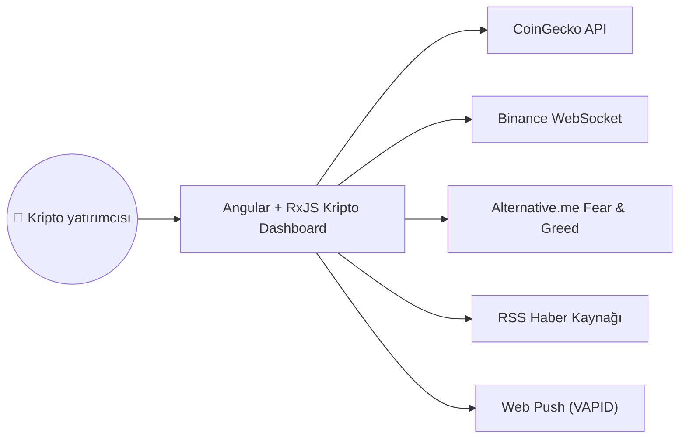
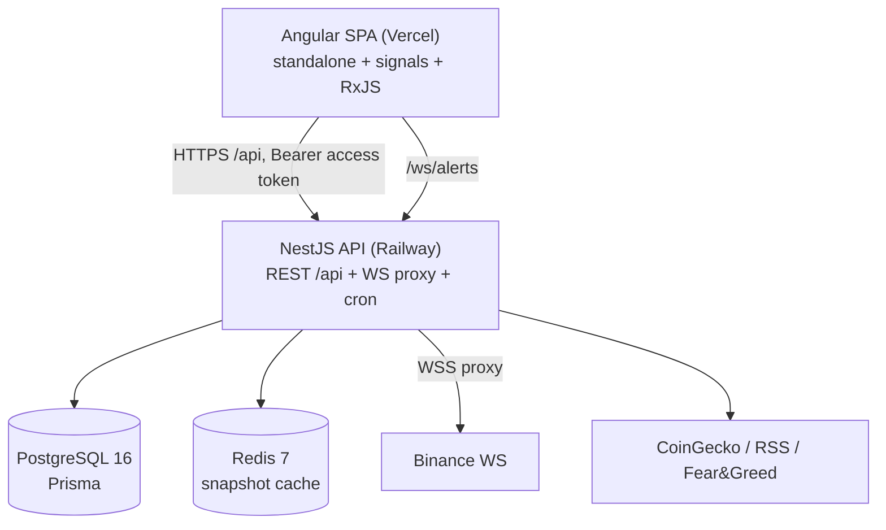
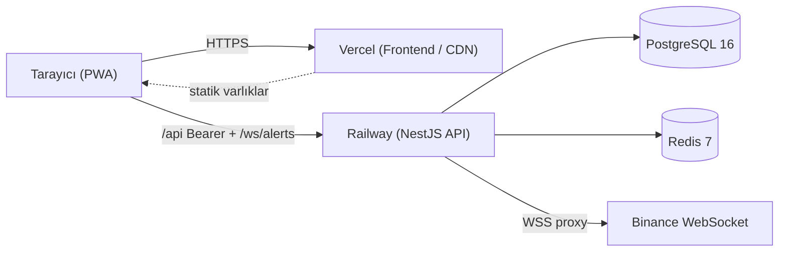

# Sistem Mimarisi

Angular + RxJS Kripto Dashboard'un mimari dokümanı. Diğer Türkçe
diyagram dokümanları: [Veri Modeli (ERD)](erd.md) ·
[Kullanıcı Akışları](user-flow.md).

## 1. Yüksek Seviye (Bağlam — C4 Level 1)

Kullanıcı tarayıcıdan (PWA) uygulamaya erişir. Sistem; piyasa verisi
için CoinGecko'ya, canlı fiyat için Binance WebSocket'e, piyasa
duyarlılığı için Alternative.me Fear & Greed'e, haber için RSS
kaynağına ve bildirim için Web Push (VAPID) servisine bağlanır.

## 2. Container Seviyesi (C4 Level 2)

- **Angular SPA** (Vercel): standalone bileşenler, signals + RxJS,
  Angular Material + Tailwind, ApexCharts, PWA + Web Push.
- **NestJS API** (Railway): REST `/api`, `/ws/alerts` WebSocket bildirim,
  Binance WS proxy gateway, `@nestjs/schedule` cron işleri.
- **PostgreSQL 16** (Prisma ORM): kalıcı veri.
- **Redis 7**: yalnızca CoinGecko piyasa anlık görüntüsü (snapshot) önbelleği.

## 3. Dağıtım Topolojisi

Production'da frontend Vercel CDN üzerinden statik servis edilir; API
Railway'de çalışır ve PostgreSQL + Redis'e bağlanır. Canlı fiyat için
Railway'deki API Binance WS'e sunucu tarafı proxy kurar (tarayıcı
doğrudan Binance'e bağlanmaz). CORS `FRONTEND_ORIGIN`'e sabitlenmiştir;
`refresh_token` çerezi cross-site (prod) ortamda `Secure` +
`SameSite=None`, yerel geliştirmede `SameSite=Lax`'tir.

## 4. Teknoloji Yığını

- **Frontend:** Angular 17, RxJS 7, Tailwind, Angular Material,
  ApexCharts; PWA + Web Push.
- **Backend:** NestJS 11, Prisma 5, PostgreSQL 16.
- **Önbellek:** Redis (yalnızca CoinGecko piyasa snapshot'u).
- **Kimlik doğrulama:** Argon2id + JWT — kısa ömürlü **Bearer access
  token (yanıt gövdesinde)** + **httpOnly `refresh_token` çerezi** (7
  gün), yenilemede rotasyon, `User.logoutAllAt` ile tüm cihazlarda
  anında oturum iptali.
- **Test:** Jest (birim, kaynak yanında `*.spec.ts`), Jest+Supertest
  backend e2e ve Playwright frontend e2e — ikisi de `repo/tests/` altında.
- **CI/CD:** GitHub Actions (iş akışları git deposu kökündeki
  `.github/`), Vercel, Railway.
- **API:** `@nestjs/swagger` ile OpenAPI 3 → `../openapi.yaml`
  (CI'da drift kontrollü).

## 5. Güvenlik Özeti

Helmet (HSTS/CSP/nosniff/X-Frame-Options/Permissions-Policy),
`FRONTEND_ORIGIN`'e sabit CORS allowlist, `@nestjs/throttler` hız
sınırlama + kullanıcı bazlı hesap kilidi, açılışta JWT-secret
sertleştirme. **CSRF koruması yapısaldır** — access token hiçbir zaman
çerez değildir, dolayısıyla durum değiştiren uçlar ortam (ambient)
kimlik bilgisi taşımaz (`csurf` kaldırıldı; prod'da cross-origin POST'u
bozuyordu). Tehdit modeli: [../adr/ADR-007-threat-model.md](../adr/ADR-007-threat-model.md).
OWASP ZAP taraması: [../security-scan-2026-05-18.md](../security-scan-2026-05-18.md).
