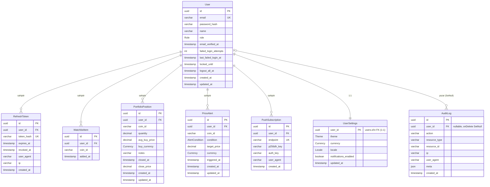

# Veri Modeli (ERD)

`repo/backend/prisma/schema.prisma` dosyasının birebir yansıması. Bu
diyagram PROJE-RAPORU.md §9.1 ile aynı kaynaktan üretilir (tek doğruluk
kaynağı). İlgili dokümanlar: [Sistem Mimarisi](architecture.md) ·
[Kullanıcı Akışları](user-flow.md).

**Enum'lar:** `Role` = USER · ADMIN | `AlertCondition` = ABOVE · BELOW |
`Currency` = USD · EUR · TRY | `Theme` = LIGHT · DARK · SYSTEM |
`Locale` = TR · EN.

**Index / benzersizlik kısıtları:** `users.email` UNIQUE ·
`refresh_tokens.token_hash` UNIQUE + index `(user_id, revoked_at)` ·
`watchlist_items` UNIQUE `(user_id, coin_id)` ·
`portfolio_positions` index `(user_id, closed_at)` ·
`price_alerts` index `(user_id, triggered_at)` + `(triggered_at)` ·
`push_subscriptions.endpoint` UNIQUE + index `(user_id)` ·
`audit_log` index `(user_id, created_at)` + `(action, created_at)`.
Tüm `user_id` yabancı anahtarları `onDelete: Cascade`'tir
(`audit_log` hariç — `SetNull`, denetim izi kullanıcı silinse de kalır).

*Kaynak: [../../backend/prisma/schema.prisma](../../backend/prisma/schema.prisma)*
