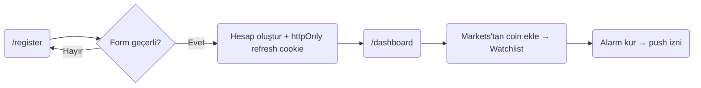
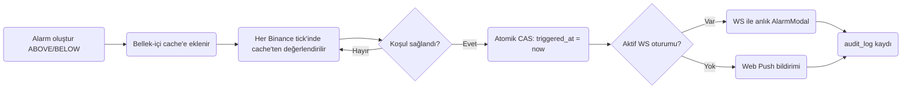

# Kullanıcı Akışları

Ana kullanıcı akışlarının Türkçe diyagramları (PROJE-RAPORU.md §10.2 ile
aynı kaynak). İlgili dokümanlar: [Sistem Mimarisi](architecture.md) ·
[Veri Modeli (ERD)](erd.md). Alarm tetikleme akışının sıralı (sequence)
gösterimi PROJE-RAPORU.md §8.3.2'dedir.

## Akış 1 — İlk Kayıt ve İlk Kullanım

*Not: E-posta doğrulama V1 kapsamında zorunlu değildir; kayıt sonrası
doğrudan dashboard'a geçilir. Access token yanıt gövdesinde döner
(Bearer); yalnızca `refresh_token` httpOnly çerez olarak set edilir.*

## Akış 2 — Alarm Tetikleme

*Not: Aktif alarmlar uygulama açılışında (`onApplicationBootstrap`) bir
kez DB'den okunup bellek-içi cache'e yüklenir; değerlendirme her Binance
tick'inde bu cache üzerinden yapılır. `snapshot.updated` olayı yalnızca
sembol haritası, döviz kuru ve Binance aboneliklerini tazeler — alarm
değerlendirmesi yapmaz. Atomik CAS (`updateMany WHERE id AND
triggered_at IS NULL`) çift bildirimi önler.*
